<a href="https://agenciarse.com/estudio/">
  <picture>
    <source media="(prefers-color-scheme: dark)" srcset="assets/banner-dark.svg">
    
  </picture>
</a>

<p align="center">
  <a href="https://agenciarse.com/estudio/"></a>
  <a href="https://www.linkedin.com/in/meijide/"></a>
  <a href="https://profiles.wordpress.org/dmeijide/"></a>
</p>

### Hola, soy Diego 👋

Desde febrero de 2018 dirijo **[AGENCIA RSE](https://agenciarse.com/estudio/)**, un estudio pequeño de diseño y desarrollo WordPress de A Coruña. También trabajo en Barcelona con la agencia SEO [Orbitalia](https://www.orbitalia.com/). Llevo cada proyecto de principio a fin: quien habla contigo es quien toca tu web.

```yaml
diego_meijide:
  estudio: AGENCIA RSE            # A Coruña · también en Barcelona
  desde: 2018-02
  hago:
    - mantenimiento y seguridad WordPress
    - diseño web WordPress
    - WooCommerce
    - IA en WordPress             # permisos limitados y opción de deshacer
    - software a medida y extensiones de navegador
  reglas:
    - presupuesto cerrado y por escrito
    - copia antes de tocar nada
    - todo es tuyo: accesos, código y contenido
```

### Qué hago

| | Servicio | |
|:-:|---|---|
| 🛡️ | **Mantenimiento y seguridad WordPress**: actualizaciones con copia previa, limpieza de malware, migraciones y velocidad | [Ver](https://agenciarse.com/mantenimiento-wordpress/) |
| 🎨 | **Diseño web WordPress**: webs nuevas y rediseños, con el constructor que encaje | [Ver](https://agenciarse.com/diseno-web-wordpress/) |
| 🛒 | **WooCommerce**: tiendas, integraciones con proveedores y ERP, y Verifactu | [Ver](https://agenciarse.com/integraciones-woocommerce/) |
| 🤖 | **IA en WordPress**: asistentes y conexión de Claude o ChatGPT a tu web | [Ver](https://agenciarse.com/ia-wordpress/) |
| 🧩 | **Software a medida y extensiones de navegador** (Manifest V3) | [Ver](https://agenciarse.com/extensiones-navegador/) |

### Con qué trabajo

<p>
  
  
  
  
  
  
  
  
  
  
</p>

### Extensiones publicadas

- **[KVM Console Paste](https://agenciarse.com/extensiones-navegador/kvm-console-paste/)**: pega texto en consolas KVM web (noVNC) simulando pulsaciones. Gratis en Chrome Web Store.
- **[Tab Audio Recorder](https://agenciarse.com/extensiones-navegador/tab-audio-recorder/)**: graba el audio de una pestaña de Chrome en WebM o MP3, todo en local.

### Código abierto

- **[DeskWidgets](https://github.com/agenciaRSE/deskwidgets)**: widgets nativos para el escritorio de Windows con Wi-Fi y red, rendimiento del PC y consumo de Claude Code (tokens, coste y límites de 5 h y semanal). Sin instaladores ni dependencias.

### Cómo uso la IA

> La IA me asiste; no me dirige. La uso a diario para programar y revisar, pero las decisiones las toma una persona y cada cambio se revisa antes de llegar a tu web.

### Mi actividad

<picture>
  <source media="(prefers-color-scheme: dark)" srcset="https://raw.githubusercontent.com/agenciaRSE/agenciaRSE/output/github-snake-dark.svg">
  
</picture>

<details>
<summary><b>🇬🇧 English</b></summary>

<br>

I'm Diego Meijide, founder of **[AGENCIA RSE](https://agenciarse.com/en/studio/)**, a small WordPress design and development studio from A Coruña, Spain, since February 2018. I also work in Barcelona with the SEO agency [Orbitalia](https://www.orbitalia.com/). I handle every project from start to finish: the person you talk to is the person working on your site.

- **WordPress maintenance and security**: updates with a backup first, malware removal, migrations and speed. [More](https://agenciarse.com/en/wordpress-maintenance/)
- **WordPress web design**: new websites and redesigns. [More](https://agenciarse.com/en/wordpress-development/)
- **WooCommerce**: shops, supplier and ERP integrations, and Verifactu. [More](https://agenciarse.com/en/woocommerce-integrations/)
- **AI for WordPress**: assistants and connecting Claude or ChatGPT to your site, with limited permissions and a way to undo. [More](https://agenciarse.com/en/wordpress-ai/)
- **Custom software and browser extensions** (Manifest V3). [More](https://agenciarse.com/en/browser-extensions/)

Open source: **[DeskWidgets](https://github.com/agenciaRSE/deskwidgets)**, native Windows desktop widgets for Wi-Fi and network, PC performance and Claude Code usage (tokens, cost and the 5-hour and weekly limits). No installers, no dependencies.

AI assists me; it doesn't direct me. A person makes the decisions and every change is reviewed before it goes live.

</details>

---

<p align="center"><sub>Hecho en A Coruña · <a href="https://agenciarse.com/estudio/">agenciarse.com/estudio</a></sub></p>
